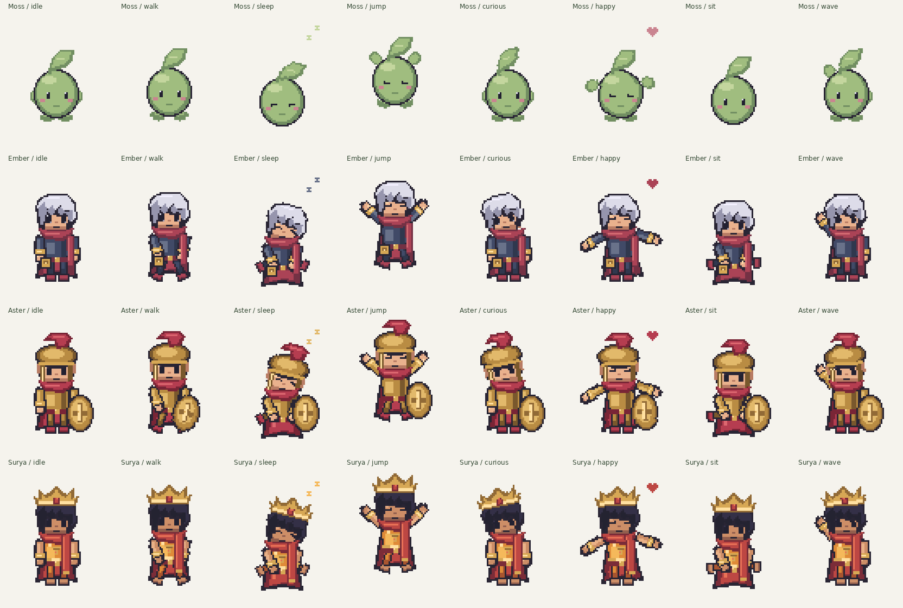

# Pixel character engine

LittleLife composes its characters from code-defined pixel layers. No PNG, image URL, sprite sheet, image-generation API, or network request is used to render a character. The documentation preview below is an output of the engine, not an input asset.



## Try it

Click **Characters ↗** on the companion card, or open **Little settings → Pixel character workshop**.

- Choose Moss the leaf spirit, Ember the sky scout, Aster the dawn guard, or Surya the sun keeper.
- Change outfit and accent colors, or reset the original palette.
- Choose front, right, back, or left. Automatic direction follows walking; left mirrors the authored right view.
- Preview idle, walk, sleep, jump, curious, happy, sit, or wave.

Normal companion behavior and Jev use the existing six actions. Sitting, waving, flying, swimming, dancing and being angry are extra visual poses, so no new model permission or API call is needed. A care action returns the renderer to automatic behavior. Preview poses are not saved across launches. Appearance, colors and direction are saved separately from pet state; changing a look keeps energy and bond. A custom name is preserved unless it matches the previous character's default name.

## Model

| Module | Responsibility |
| --- | --- |
| `src/pixel/engine.ts` | Rig, pose clips, frame sampling, inverse-sampled pixel composition, validation and palette shading |
| `src/pixel/art.ts` | Four original character definitions, authored pixel shapes, profile/rear views, expression layers and equipment |
| `src/pixel/player.ts` | Canvas painting, integer display scaling, frame cache and timer lifecycle |
| `src/pixel/appearance.ts` | Validated local appearance preferences |

The logical canvas is **64 × 80 pixels**. Art is authored in a shared 48 × 64 space, with margins for jumping and equipment. Tokens in each grid select colors from a palette; `.` is transparent. Outfits use `p/q/r` for base/shadow/highlight and accessories use `a/b/c`. Hair, skin, eyes, outlines and metal have independent roles.

Seven bones attach the root, body, head, two arms, and two legs. Each pose is a clip of timed, discrete transforms. Parts inherit their bone transforms. The compositor inverse-samples these layers onto integer destination pixels, avoiding gaps when a layer rotates. Right-facing and rear-view art can replace individual layers; left-facing art is mirrored after composition. Eyes switch between normal, blinking, closed, and happy variants. Equipment can change attachments for a pose, such as resting a shield beside the character while sitting.

This is a 2D cutout rig with authored views, not a 3D model or an automatic converter for arbitrary photos. Complex new anatomy needs appropriate parts and bone attachments. The current workshop edits appearance and previews poses; it is not a freehand pixel editor or an untrusted character-pack importer.

## Add a character

Define a `PixelCharacter`, validate it, and register it in `CHARACTERS`. Each `Part` needs an ID, attachment bone, integer position, and a rectangular token grid. Existing pose clips immediately work with correctly attached parts.

```typescript
import { CHARACTERS } from './art';
import { validateCharacter, type PixelCharacter } from './engine';

const pebble: PixelCharacter = {
  id: 'pebble',
  name: 'Pebble',
  title: 'SMALL WANDERER',
  palette: { ...CHARACTERS[0].palette, p: '#7999b5' },
  parts: [{
    id: 'body', bone: 'body', x: 18, y: 34,
    pixels: [
      '..oooo..',
      '.oppppo.',
      'opprrppo',
      'oppppppo',
      '.oqqqqo.',
      '..oooo..',
    ],
  }],
};
validateCharacter(pebble);
```

The drawing helpers in `art.ts` create grids using rectangles, ellipses and polygons. A detailed character uses separate head, face, hair, limbs, clothing, and equipment parts. The sample above illustrates the data contract, not a finished character. Keep the `a` and `r` palette roles for shared heart/sleep effects.

## Runtime and verification

Native exploring can use flying/swimming clips while keeping the behavior/model action vocabulary unchanged. The gallery image above predates those two added clips.

The player ticks at eight updates per second and repaints only when the sampled frame, expression, facing, character or colors change. It stops its timer while hidden, paused, or in reduced motion. Reduced motion samples a stable pose. Canvas image smoothing is disabled, display size uses integer multiples, and desktop wandering moves in pixel steps. These are implementation constraints, not measured CPU or battery guarantees.

Tests cover every built-in character, pose keyframe and facing, checking palette completeness, transparent margins, bounds, mirrored profiles, distinct rear views, animation sampling and preference recovery. Browser flows verify character/color persistence, previews, care overrides, pause, reduced motion, and compact integer scaling. Native monitor scaling and power use remain device acceptance checks.

All bundled character definitions are original project artwork under the repository's MIT license. The supplied Google examples were visual references; their image files are not bundled with the app.
